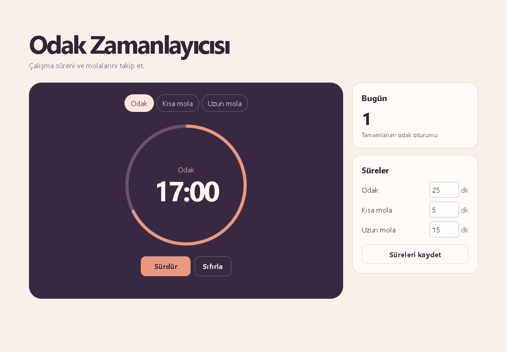

# Odak Zamanlayıcısı

Tarayıcıda çalışan odak ve mola zamanlayıcısı. Kısa ve uzun mola süreleri ayrı ayarlanır. Tamamlanan odak oturumlarını gün bazında sayar.

## Kullanım

1. Depoyu indir veya klonla. `index.html` dosyasını güncel bir tarayıcıda aç.
2. **Odak**, **Kısa mola** veya **Uzun mola** seç ve **Başlat** düğmesine bas.
3. Süreleri sağdaki ayarlardan 1–180 dakika aralığında değiştirebilirsin. Yeni süre kaydedildiğinde seçili zamanlayıcı sıfırlanır. Mod değiştirmek de önceki sayacı sıfırlar.

Çalışan sayaç bitiş zamanını kullanır. Arka plan sekmesinden döndüğünde geçen süre hesaba katılır. Tarayıcı depolaması açıksa sayacı, ayarları ve bugünkü oturum sayısını aynı tarayıcıda yeniden açabilirsin. Sayaç bittiğinde sayfada tamamlanma mesajı görünür ve sonraki modu sen başlatırsın.

Tarayıcıların yerel dosya depolama davranışı değişebilir. Aynı adreste kalıcı depolamayı kullanmak için depo kökünde `python -m http.server 8000 --bind 127.0.0.1` çalıştırıp `http://127.0.0.1:8000` adresini açabilirsin.

## Test

Node.js 22 veya üzeriyle depo kökünde `node --test` çalıştır. Testler duraklatma, sekmeyi yeniden açma, süre ayarı ve oturum sayacını kapsar.
